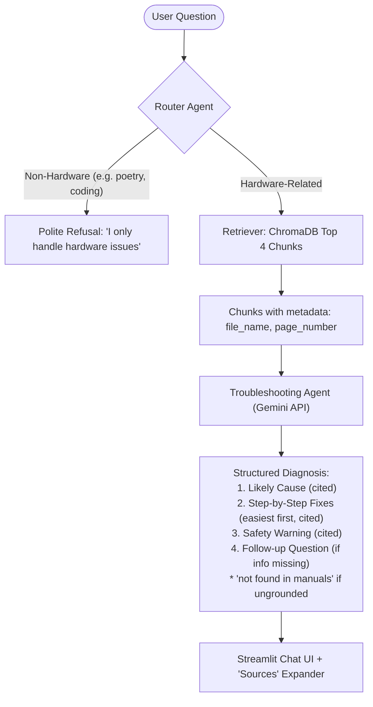

# 🛠️ AI Technical Support System

An agentic Python application for hardware technical support powered by the **Google Gemini API**, **ChromaDB**, and a **Streamlit** chat interface.

The system ingests hardware service manuals (PDFs), splits them into 800-token chunks, and uses multi-agent orchestration (Router Agent + Troubleshooting Agent) to provide precise, grounded repair instructions strictly cited with manual names and page numbers.

---

## 🌟 Architecture & Agent Workflow



---

## 📦 Project Structure

```text
ai_tech_support/
├── manuals/                                     # Directory storing hardware PDF manuals
│   └── Dell_Inspiron_Hardware_Maintenance_Manual.pdf  # Pre-generated sample technical manual
├── chroma_db/                                   # Persistent vector store for manual chunks
├── ingest.py                                    # PDF loader, 800-token chunker & ChromaDB indexing
├── retriever.py                                 # Retrieves top 4 relevant chunks with metadata
├── agents.py                                    # Router Agent & Troubleshooting Agent
├── app.py                                       # Streamlit chat UI with upload sidebar & sources expander
├── create_sample_manual.py                      # Utility script to generate sample multi-page manual
├── requirements.txt                             # Python package dependencies
├── .env.example                                 # Environment variable template
├── .env                                         # Your local Gemini API key configuration
└── README.md                                    # Setup and usage guide
```

---

## ⚙️ Core Modules

### 1. `ingest.py`
- Discovers all PDF files inside `/manuals`.
- Reads pages with `pypdf.PdfReader`.
- Splits page contents into **800-token chunks** preserving word boundaries and page metadata.
- Upserts documents into **ChromaDB** with metadata: `file_name`, `page_number`, and `chunk_index`.

### 2. `retriever.py`
- Accepts any diagnostic query (e.g. *"My laptop fan is very loud"*).
- Queries ChromaDB and returns the **top 4 most relevant chunks**.
- Formats each chunk with `text`, `file_name`, `page_number`, and `distance`.

### 3. `agents.py`
- **Router Agent**:
  - Analyzes user input to classify whether it pertains to physical computer/device hardware.
  - Politely refuses non-hardware questions (e.g. creative writing, pure software coding, general chat).
- **Troubleshooting Agent**:
  - Uses the top 4 retrieved manual excerpts.
  - Produces:
    - **Likely Cause**: Diagnostic causes found in the manuals.
    - **Step-by-Step Fixes**: Sequential steps ordered from easiest / least-invasive (airflow, vent cleaning, BIOS profile) to invasive repairs (disassembly, heatsink removal, fan replacement).
    - **Safety Warning**: Strict electrical and mechanical precautions (unplugging AC adapter and battery, ESD grounding, fan over-spin prevention).
    - **Follow-up Question**: Asks exactly **one** targeted question if key information is missing (e.g., sound type).
  - Strictly cites manual name and page number `[Manual_Name.pdf, Page X]`.
  - Strictly outputs `"not found in manuals"` for any ungrounded claim.

### 4. `app.py`
- Interactive **Streamlit** chat UI.
- **Sidebar**:
  - Live Gemini API Key configuration.
  - PDF manual uploader to add new manuals directly into `/manuals`.
  - "Re-index" and "Clear DB" controls.
  - Real-time knowledge base statistics (manuals count, indexed chunk count).
- **Main Chat Area**:
  - Sample prompt buttons for quick testing.
  - Chat history with user and assistant turns.
  - Collapsible **"📚 Sources"** expander beneath each answer detailing top cited chunks, source file names, page numbers, and cosine similarity distances.

---

## 🚀 Setup & Run Instructions

### 1. Clone or Open the Project
```bash
cd "C:\Users\prera\.gemini\antigravity\scratch\ai_tech_support"
```

### 2. Configure Your Gemini API Key
Create or edit your `.env` file:
```env
GEMINI_API_KEY=your_actual_gemini_api_key_here
```
> *Note: You can also enter or override your API key directly in the Streamlit UI sidebar.*

### 3. Install Dependencies
```bash
pip install -r requirements.txt
```

### 4. Ingest the Manuals
The project includes a sample 4-page manual (`Dell_Inspiron_Hardware_Maintenance_Manual.pdf`). Index it by running:
```bash
python ingest.py
```

### 5. Launch the Streamlit App
```bash
streamlit run app.py
```
The app will open automatically in your browser at `http://localhost:8501`.

---

## 🧪 Testing the System

### Test 1: Hardware Troubleshooting (Sample Query)
Ask:
> **"My laptop fan is very loud"**

**Expected Behavior:**
1. **Router Agent** classifies the question as `HARDWARE: YES`.
2. **Retriever** fetches Page 3 (Cooling Fan and Thermal Noise Troubleshooting) and Page 2 (Safety Warnings).
3. **Troubleshooting Agent** outputs:
   - **Likely Cause**: Dust accumulation on heatsink fins, blocked vents, dried thermal paste, BIOS fan curve, or fan bearing wear `[Dell_Inspiron_Hardware_Maintenance_Manual.pdf, Page 3]`.
   - **Step-by-Step Fixes**: Easiest first (Step 1: Check airflow/desk clearance -> Step 2: Compressed air on vents -> Step 3: BIOS update & Dell Power Manager -> Step 4: Internal fin inspection -> Step 5: Thermal paste/fan replacement).
   - **Safety Warning**: Disconnect AC power and battery; do not spin fans with compressed air `[Dell_Inspiron_Hardware_Maintenance_Manual.pdf, Page 2]`.
   - **Follow-up Question**: Asks whether the noise is a fast rushing air sound or a mechanical grinding/rattling sound.
4. **Sources Expander**: Expands to show the 4 retrieved chunks with file name and page numbers.

### Test 2: Non-Hardware Rejection
Ask:
> **"Write a poem about fast racing cars"**

**Expected Behavior:**
1. **Router Agent** classifies as non-hardware.
2. System politely refuses:
   > *"I apologize, but as the AI Technical Support System, I specialize strictly in hardware technical support, physical diagnostics, and manual-guided repairs. Your question does not appear to be related to computer hardware..."*
3. No manual retrieval is performed and no sources expander is rendered.

