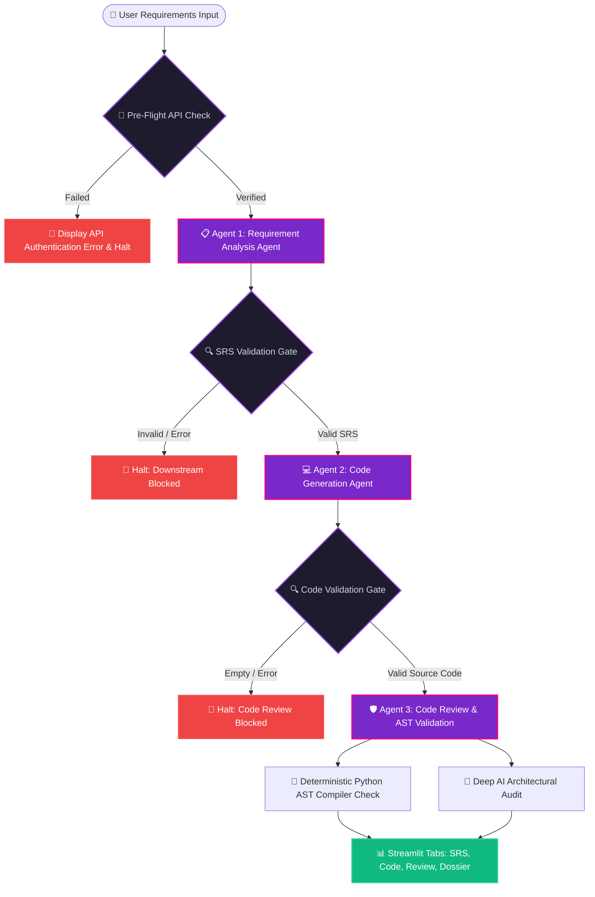

# ⚡ AI Multi-Agent Software Development System (Debugged & Verified)

An autonomous multi-agent software engineering framework developed using **Python**, **Google Gemini API** (`google-genai` SDK), **LangGraph**, and **Streamlit**.

The system simulates a collaborative software engineering team consisting of three specialized AI agents that execute sequentially with strict validation gates:
1. **Agent 1: Requirement Analysis Agent (SRS)**
2. **Agent 2: Code Generation Agent (Production Code)**
3. **Agent 3: Code Review & Deterministic Python AST Validation Agent**

---

## 🛠️ Root Causes & Implemented Fixes

### 1. Google Gemini API Integration (`google-genai` SDK)
- **Problem:** Missing or placeholder API keys caused `400 INVALID_ARGUMENT: API key not valid` errors, and the previous setup used deprecated or indirect wrappers without pre-flight validation.
- **Fix:** 
  - Integrated the official `google-genai` SDK (`from google import genai`).
  - Securely reads `GEMINI_API_KEY` from `.env` via `python-dotenv`.
  - Added an active **"🔌 Test Connection"** mechanism in the sidebar (`validate_api_connection`) to verify credentials and model accessibility before executing pipelines.
  - Informative error handling for invalid keys, expired keys, model unavailability, and quota limits.

### 2. Guard Gates & Downstream Execution Isolation
- **Problem:** When Agent 1 failed, downstream agents still executed, producing cascading errors like `"Code generation could not proceed: SRS report is missing or invalid"`.
- **Fix:**
  - Implemented LangGraph conditional routing gates (`srs_validation_gate` and `code_validation_gate`).
  - If Agent 1 fails or produces an empty/invalid SRS, the workflow halts immediately with status `Failed`.
  - Downstream agents remain `Pending` / `Blocked` and are never executed without valid prerequisites.

### 3. Accurate Deterministic AST Syntax Validation
- **Problem:** Code Review Agent reported syntax errors when no code was generated (`No code present to validate`).
- **Fix:**
  - The AST validator now distinguishes between **code with syntax errors** and **code not yet generated**.
  - When no code is available, it displays: `"Code generation has not completed yet. No code available for AST validation."`
  - When Python code is analyzed, `ast.parse` pinpoints the exact line number, column offset, offending code snippet, and actionable suggested fixes.

---

## 🏗️ System Architecture & Workflow



---

## 📁 Project Structure

```
multi_agent_development/
│
├── app.py                      # Main Streamlit Dashboard with Validation Guards
├── test_suite.py               # 11 Unit Tests covering all Test Cases
│
├── agents/                     # Specialized AI Agents
│   ├── __init__.py
│   ├── requirement_agent.py    # Agent 1: Requirement Analysis & SRS
│   ├── code_generation_agent.py# Agent 2: Modular Source Code Generation
│   └── code_review_agent.py    # Agent 3: AST Audit & Review Report
│
├── workflow/                   # LangGraph StateGraph Orchestration
│   ├── __init__.py
│   ├── state.py                # TypedDict Shared State & Step Status Tracking
│   └── graph.py                # StateGraph with Conditional Validation Gates
│
├── utils/                      # Core Utility Layer
│   ├── __init__.py
│   ├── llm.py                  # google-genai Integration & Connection Validator
│   └── validators.py           # Python AST Compiler & SRS/Code Validators
│
├── outputs/                    # Output directory for exported files
│   └── .gitkeep
│
├── .env                        # Local Environment Configuration (Ignored)
├── .env.example                # Sample Environment Template
├── .gitignore                  # Git Ignore Specifications
├── requirements.txt            # Python Dependencies
└── README.md                   # System Documentation & Technical Guide
```

---

## 🔑 Environment Configuration

Create or update `.env` in the workspace root or `multi_agent_development/`:

```env
GEMINI_API_KEY=your_actual_gemini_api_key_here
GEMINI_MODEL=gemini-2.5-flash
```

*(You can also paste the API key directly into the Streamlit sidebar field and click **"🔌 Test Connection"** to verify).*

---

## 🧪 Automated Test Suite Verification

Run the comprehensive unit test suite:

```powershell
python multi_agent_development/test_suite.py
```

All 11 unit tests verify:
- **Test Case 1:** Valid Python Code AST parsing (classes, functions, imports).
- **Test Case 2:** Invalid / Missing API Key handling.
- **Test Case 3:** Missing/Failed SRS halts downstream execution (`srs_validation_gate`).
- **Test Case 4:** Invalid Python code detects syntax errors, line numbers, and suggested fix hints.
- **Test Case 5:** Empty/pending code returns informative message without false syntax errors.
- **Test Case 6:** Missing/Placeholder code halts code review (`code_validation_gate`).
- **Test Case 7:** StateGraph compilation and edge integrity.

---

## 🚀 Running the Streamlit Application

Launch the application:

```powershell
streamlit run multi_agent_development/app.py --server.port 8501
```

Access the dashboard at:
👉 **`http://localhost:8501`**
