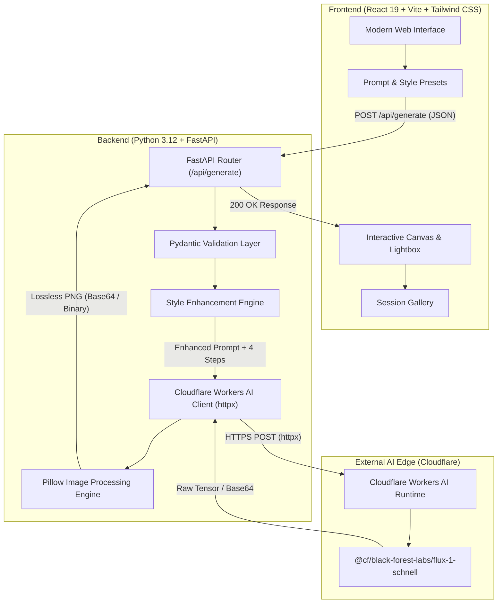
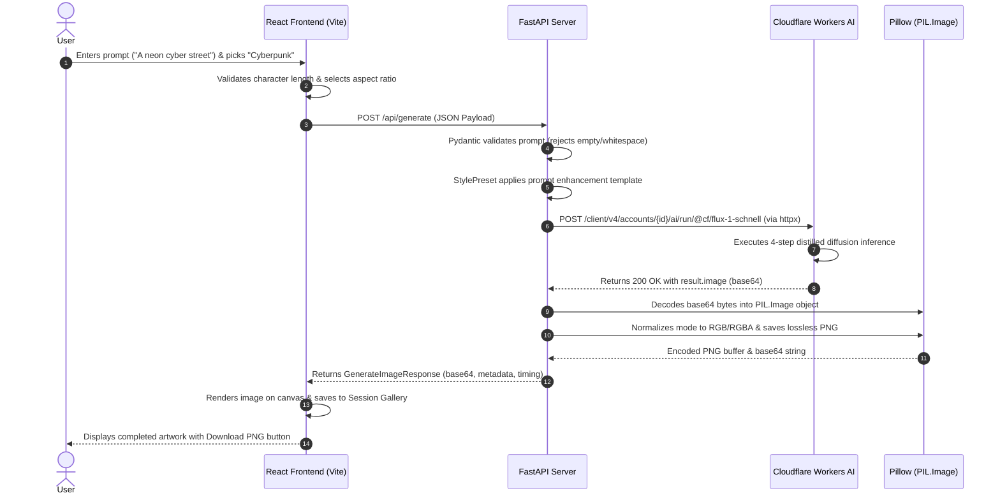

# DreamCanvas — Comprehensive Project Explanation

```
  ____                             ____                            
 |  _ \ _ __ ___  __ _ _ __ ___   / ___|__ _ _ ____   ____ _ ___   
 | | | | '__/ _ \/ _` | '_ ` _ \ | |   / _` | '_ \ \ / / _` / __|  
 | |_| | | |  __/ (_| | | | | | || |__| (_| | | | \ V / (_| \__ \  
 |____/|_|  \___|\__,_|_| |_| |_| \____\__,_|_| |_|\_/ \__,_|___/  
                                                                   
        AI Text-to-Image Generation Studio • Production Guide
```

---

## 📌 1. Project Overview & Mission

**DreamCanvas** is a full-stack, production-ready AI image generation studio designed to convert natural language text prompts into high-fidelity, high-resolution artwork in **under 3 seconds**.

### Core Problem Solved:
1. **Complex AI Infrastructure Abstracted**: Users interact with a sleek, intuitive frontend without needing to understand diffusion models, steps, latents, or API auth tokens.
2. **Speed & Latency**: Uses **`@cf/black-forest-labs/flux-1-schnell`**, a 12-billion parameter flow-matching transformer distilled to generate publication-ready images in just **4 inference steps**.
3. **Lossless Quality**: Raw inference outputs are processed and converted into optimized, lossless **PNG** format using Python's **Pillow** (`PIL.Image`) library.
4. **Reliability & Low Cost**: Powered by **Cloudflare Workers AI**, bypassing credit bottlenecks and payment gates common on traditional model hubs.

---

## 🏗️ 2. High-Level System Architecture

DreamCanvas is structured into two decoupled, independent layers: a **React + Vite** single-page frontend application and a **FastAPI** backend service.



---

## 🔄 3. End-to-End Request & Data Flow

Here is the exact step-by-step lifecycle of an image generation request:



---

## 🎨 4. Frontend Architecture (React 19 + Vite + Tailwind CSS)

The frontend is located in the `frontend/` directory and is built using modern React principles.

### Component Breakdown

| Component | File Path | Primary Responsibility |
|---|---|---|
| **`App.jsx`** | [`src/App.jsx`](file:///c:/Users/Bhosale/Downloads/genai%20prac/frontend/src/App.jsx) | Root state container (prompt, style, steps, seed, history, toast alerts). Manages layout & generation flow. |
| **`Header.jsx`** | [`src/components/Header.jsx`](file:///c:/Users/Bhosale/Downloads/genai%20prac/frontend/src/components/Header.jsx) | Sticky navigation bar displaying DreamCanvas logo, model badge, and live backend health status pill. |
| **`PromptInput.jsx`** | [`src/components/PromptInput.jsx`](file:///c:/Users/Bhosale/Downloads/genai%20prac/frontend/src/components/PromptInput.jsx) | Text input area with live character counter (up to 1,000 chars), **"Surprise Me"** randomized prompt button, quick idea inspiration tags, and `Ctrl+Enter` shortcut. |
| **`StyleSelector.jsx`** | [`src/components/StyleSelector.jsx`](file:///c:/Users/Bhosale/Downloads/genai%20prac/frontend/src/components/StyleSelector.jsx) | Visual grid of 12 artistic style presets categorized by genre with thumbnail icons, tags, and active border styling. |
| **`AdvancedOptions.jsx`** | [`src/components/AdvancedOptions.jsx`](file:///c:/Users/Bhosale/Downloads/genai%20prac/frontend/src/components/AdvancedOptions.jsx) | Collapsible drawer for resolution/aspect ratio (1:1, 16:9, 9:16, 4:3), inference steps (1–8), and custom seed for reproducible results. |
| **`ImageDisplay.jsx`** | [`src/components/ImageDisplay.jsx`](file:///c:/Users/Bhosale/Downloads/genai%20prac/frontend/src/components/ImageDisplay.jsx) | Main canvas featuring loading shimmer animation, elapsed timer, rotating generative tips, full-res preview, metadata badges, and click-to-zoom modal. |
| **`HistoryGallery.jsx`** | [`src/components/HistoryGallery.jsx`](file:///c:/Users/Bhosale/Downloads/genai%20prac/frontend/src/components/HistoryGallery.jsx) | Thumbnail gallery storing past creations in the session for quick comparison and instant re-download. |
| **`Toast.jsx`** | [`src/components/Toast.jsx`](file:///c:/Users/Bhosale/Downloads/genai%20prac/frontend/src/components/Toast.jsx) | Floating alert notification system for success, error, and informational feedback. |

### API Client Service ([`frontend/src/services/api.js`](file:///c:/Users/Bhosale/Downloads/genai%20prac/frontend/src/services/api.js))
- **`checkHealth()`**: Queries `GET /api/health` to confirm the backend is reachable and credentials are valid.
- **`generateImage(payload)`**: Dispatches the generation payload to `POST /api/generate` and parses the JSON response.
- **`downloadPngFromBase64(base64Data, filename)`**: Dynamically creates a temporary anchor element and triggers direct browser download of the lossless PNG.

### Development Proxy ([`frontend/vite.config.js`](file:///c:/Users/Bhosale/Downloads/genai%20prac/frontend/vite.config.js))
Vite proxies all `/api` requests to `http://127.0.0.1:8000`, eliminating CORS pre-flight bottlenecks during local development:
```javascript
server: {
  port: 5173,
  proxy: {
    '/api': {
      target: 'http://127.0.0.1:8000',
      changeOrigin: true,
      secure: false
    }
  }
}
```

---

## ⚡ 5. Backend Architecture (Python + FastAPI)

The backend is housed in `backend/` and follows clean architecture principles.

```
backend/
├── main.py                # FastAPI entry point, routes & CORS
├── config.py              # Environment configuration via Pydantic Settings
├── schemas.py             # Request & response data models
├── services/
│   ├── cf_generator.py    # Cloudflare Workers AI client & Pillow PNG converter
│   └── style_presets.py   # Style formulas and prompt modifiers
└── tests/
    └── test_api.py        # Automated Pytest suite
```

### 1. Configuration & Security ([`backend/config.py`](file:///c:/Users/Bhosale/Downloads/genai%20prac/backend/config.py))
Uses `pydantic_settings.BaseSettings` to load environment variables from `backend/.env` without polluting code or version control:
- `CLOUDFLARE_API_TOKEN`: Cloudflare User Token with Workers AI Edit permissions.
- `CLOUDFLARE_ACCOUNT_ID`: 32-character Cloudflare account hash.
- `CLOUDFLARE_MODEL`: Default set to `@cf/black-forest-labs/flux-1-schnell`.

### 2. Style Preset Engine ([`backend/services/style_presets.py`](file:///c:/Users/Bhosale/Downloads/genai%20prac/backend/services/style_presets.py))
Transforms raw user input into visually rich prompts using professional art-direction modifiers.

| Style ID | Name | Prefix Formula | Suffix Formula |
|---|---|---|---|
| `photorealistic` | Photorealistic | `Award-winning professional photograph of ` | `, 35mm lens, f/1.8 aperture, natural lighting, ultra-sharp focus, photorealistic 8k, hyperdetailed textures` |
| `anime` | Anime & Manga | `Anime aesthetic masterpiece, Makoto Shinkai and Studio Ghibli inspired, ` | `, vibrant colors, expressive line art, cinematic lighting, 4k anime visual novel illustration` |
| `cyberpunk` | Cyberpunk Neon | `Futuristic cyberpunk sci-fi scene of ` | `, neon soaked alleyway, holographic displays, volumetric fog, chromatic aberration, ray tracing reflections, 8k render` |
| `fantasy` | Epic Fantasy | `High fantasy digital concept art of ` | `, magical ethereal particles, atmospheric mist, grand worldbuilding, artstation trending, dramatic golden hour lighting` |
| `oil_painting` | Classic Oil Painting | `Classical oil on canvas painting of ` | `, heavy impasto brushwork, rich textural depth, chiaroscuro lighting, Rembrandt and John Singer Sargent style` |
| `3d_render` | 3D Pixar Style | `Pixar and Disney 3D animation style render of ` | `, Octane Render, subsurface scattering, soft studio lighting, cute stylized proportions, 4k resolution` |

### 3. Cloudflare Workers AI Generator ([`backend/services/cf_generator.py`](file:///c:/Users/Bhosale/Downloads/genai%20prac/backend/services/cf_generator.py))
- Calls Cloudflare's edge REST endpoint:
  `POST https://api.cloudflare.com/client/v4/accounts/{CLOUDFLARE_ACCOUNT_ID}/ai/run/@cf/black-forest-labs/flux-1-schnell`
- Uses **`httpx.Client`** with a generous 120s timeout and keep-alive connection pooling.
- Decodes `result["image"]` from base64.
- Passes raw bytes into **Pillow** (`PIL.Image.open`), ensures RGB color space, and encodes it into an optimized **lossless PNG** using `image.save(buffer, format="PNG", optimize=True)`.

### 4. Dual Format Response Support
The primary endpoint `POST /api/generate` supports both frontend consumption and direct binary streaming:
- **Default (Accept: application/json)**: Returns JSON containing `image_base64`, `prompt`, `enhanced_prompt`, `generation_time_seconds`, and dimensions.
- **Binary (Accept: image/png or ?format=raw)**: Returns direct `image/png` binary stream with `Content-Disposition` headers, suitable for command-line tools like `curl`.

---

## 🤖 6. AI Model: FLUX.1-schnell Deep Dive

**Model Name**: `@cf/black-forest-labs/flux-1-schnell`  
**Developer**: Black Forest Labs (original creators of Stable Diffusion)

### Why FLUX.1-schnell?
1. **Flow Matching vs. DDPM**: FLUX uses **rectified flow matching** instead of traditional denoising diffusion probabilistic models (DDPM). This creates a direct, linear trajectory from noise to image, drastically reducing generation steps.
2. **Distilled 4-Step Inference**: While conventional models require 25–50 steps, FLUX-schnell is specifically distilled to produce complete, detailed images in **4 steps**.
3. **Typography & Anatomy**: Excels at rendering legible text inside images and correctly proportioned hands and human anatomy.
4. **Serverless Edge Inference**: Executed over Cloudflare's worldwide GPU fleet, bringing response times down to **~2–3 seconds**.

---

## 📡 7. API Reference & Contract

### `GET /api/health`
Checks server health and credential configuration.
```json
{
  "status": "healthy",
  "app_name": "DreamCanvas AI",
  "version": "2.0.0",
  "model": "@cf/black-forest-labs/flux-1-schnell",
  "token_configured": true,
  "message": "Backend is operational and ready to generate images using Cloudflare Workers AI."
}
```

---

### `POST /api/generate`
Generates an image from a text prompt.

**Request Body:**
```json
{
  "prompt": "A majestic snow leopard resting on Himalayan peaks at sunrise",
  "style": "photorealistic",
  "width": 1024,
  "height": 1024,
  "num_inference_steps": 4,
  "seed": 42
}
```

**JSON Response (Frontend):**
```json
{
  "success": true,
  "image_base64": "iVBORw0KGgoAAAANSUhEUg...",
  "mime_type": "image/png",
  "prompt": "A majestic snow leopard resting on Himalayan peaks at sunrise",
  "enhanced_prompt": "Award-winning professional photograph of A majestic snow leopard resting on Himalayan peaks at sunrise, 35mm lens...",
  "style": "photorealistic",
  "width": 1024,
  "height": 1024,
  "seed": 42,
  "generation_time_seconds": 2.36,
  "model": "@cf/black-forest-labs/flux-1-schnell"
}
```

**Direct PNG Binary Stream:**
```bash
curl -X POST "http://127.0.0.1:8000/api/generate?format=raw" \
  -H "Content-Type: application/json" \
  -d '{"prompt": "A futuristic city in clouds", "style": "cyberpunk"}' \
  --output city.png
```

---

## 🔒 8. Security & Environment Configuration

- **Zero Client Token Exposure**: Credentials (`CLOUDFLARE_API_TOKEN` and `CLOUDFLARE_ACCOUNT_ID`) reside solely in `backend/.env`. The client browser never receives or handles secrets.
- **Git Protection**: `backend/.env`, root `.env`, and virtual environment folders are ignored via [`.gitignore`](file:///c:/Users/Bhosale/Downloads/genai%20prac/.gitignore).
- **Validation**: Pydantic v2 rejects empty or whitespace-only inputs (`422 Unprocessable Entity`) and guards against parameter boundary overflow.

---

## 🧪 9. Automated Testing & Verification

The project includes an automated test suite ([`backend/tests/test_api.py`](file:///c:/Users/Bhosale/Downloads/genai%20prac/backend/tests/test_api.py)) covering:
1. Root `/` service metadata.
2. `/api/health` credential inspection.
3. `/api/styles` catalog delivery.
4. Prompt style enhancement logic.
5. Input validation (whitespace rejection).
6. Missing credentials error reporting (HTTP 401).
7. Cloudflare Workers AI response decoding (`result.image` base64).
8. Binary `image/png` stream verification.

Run the test suite with:
```powershell
$env:PYTHONPATH="."; .\backend\.venv\Scripts\pytest.exe .\backend\tests -v
```

All 8 tests pass in **~1.2 seconds**.

---

## 🚀 10. How to Run

### Start the FastAPI Backend
```powershell
$env:PYTHONPATH="."; .\backend\.venv\Scripts\python.exe -m uvicorn backend.main:app --reload --port 8000
```

### Start the React Frontend
```powershell
cd frontend
npm run dev
```

Open **`http://localhost:5173`** in your browser to start creating artwork!

